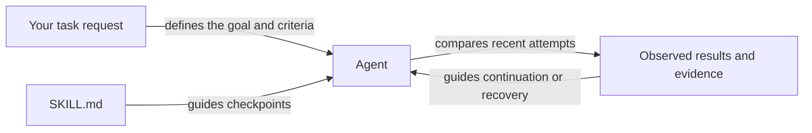

# Dead End Detector

A portable [Agent Skills](https://agentskills.io/specification) skill that helps an agent recognize a stalled approach and choose a bounded recovery across different tasks.

**The skill works on its own.** The installable package contains [SKILL.md](skills/dead-end-detector/SKILL.md) and the MIT license notice. Normal use requires no Python, JSONL, event log, or host adapter. An optional checker remains in this repository as developer tooling; it is not installed with the skill.

Created by Abdulrahman Qabbout. Licensed under the [MIT License](LICENSE); a copy is included in the installable skill directory.

## Use the skill

Install through the [skills CLI](https://github.com/vercel-labs/skills), selecting your agent when prompted:

```sh
npx skills add Qabbout/dead-end-detector --skill dead-end-detector
```

For a user-wide Codex installation:

```sh
npx skills add Qabbout/dead-end-detector --skill dead-end-detector --agent codex --global
```

You can also copy [the skill directory](skills/dead-end-detector/) into a location supported by your agent, including `LICENSE`. From a repository checkout, install for your Codex user:

```sh
mkdir -p ~/.agents/skills
cp -R skills/dead-end-detector ~/.agents/skills/
```

Codex uses `.agents/skills/` for project skills and `~/.agents/skills/` for user skills. In Codex CLI/IDE, invoke `$dead-end-detector`; restart if it does not appear. Claude Code uses `.claude/skills/` or `~/.claude/skills/` and `/dead-end-detector`. Other hosts need compatible skill loading or an explicit request to read `SKILL.md`.

```text
Use dead-end-detector while working on this task.
Apply its checkpoints directly from your existing observations.
```

The agent derives the goal and success criteria, keeps brief attempt notes in its working context, and checks for repetition or useful evidence before continuing. You do not need to supply detector fields or create an event file.

Routine detector checkpoints stay in working context while progress continues. Detector-specific reports are reserved for reassessment, blockers, or clarification needing attention. Normal progress updates and requested reporting still continue.

## How it works



Progress means advancement toward acceptance criteria or new useful evidence. A failing test can narrow a cause; a successful search can contribute nothing relevant. Equivalent attempts retain their meanings, unrelated work does not erase earlier attempts, and relevant context changes must be verified.

| Observation | Response |
| --- | --- |
| New useful evidence | Continue the investigation |
| Two equivalent failures without useful new evidence | Pause and reassess before another attempt |
| A third equivalent failure, a failed A/B/A/B cycle, or four attempts without useful evidence | Stop repeating the approach; choose a different hypothesis and a small probe |
| Authorized operation is demonstrably running | Wait through a bounded host mechanism |
| Permission, input, or external dependency is missing | Report the precise dependency; continue independent authorized work |
| Observations are missing | Gather evidence and keep uncertainty explicit |

After two equivalent failures, allow at most one further equivalent attempt only when concrete evidence justifies a bounded retry within existing authorization and time/cost/retry limits. Otherwise change the hypothesis or report what is needed. Clear contradictions warrant stopping earlier. Waiting and blockers do not erase failed attempts; useful progress or verified context changes begin a new comparison. These are default heuristics, not calibrated probabilities; stricter limits prevail. A local stall does not prove the objective is impossible, and a decision alone does not prove completion.

For example, if two timeout tweaks repeat an already-known HTTP 401 without useful new evidence, the agent should reassess the timeout hypothesis and choose a different authorized probe, such as inspecting a sanitized authentication result. Recovery must respect existing permissions and time, cost, and retry limits.

## Early experiment results

In an early observational source-review comparison using GPT-6.1 Sol on one repository across four matched pairs, skill-assisted runs preserved or increased reported finding counts (**37 to 40** overall), covered more reviewer-classified distinct defect families (**19 to 25; 31.6% more**), and had **11.9% lower summed task duration**. These additional observed benefits do not establish causal improvement, better accuracy, or fewer dead ends.

## Optional developer checker

The [checker](tools/check.py) is for maintainers, explicit reproducible checks, and host integrations. Developers opt in by invoking it directly; there is no enable switch. It requires Python 3.10+ and no additional packages. From a checkout of this repository:

```sh
python3 tools/check.py examples/repeated-failure.jsonl
```

The two-event example returns `suspect` with reason `repeated-failure` and next action `reassess-approach`. This advice does not authorize a retry. With the repository available to an agent, you can explicitly ask:

```text
Use the optional checker for this task.
Derive its inputs from observed attempts and inspect its returned decision.
```

The agent prepares complete sanitized observations itself and invokes the available tool within existing authorization. Use [the example JSONL](examples/repeated-failure.jsonl) and the schema in [tools/check.py](tools/check.py) as references. Each chronological record requires `goal`, `context`, `approach`, `hypothesis`, `outcome`, and boolean `progress`. `outcome` is `success`, `failure`, `blocked`, or `waiting`; failures require `failure`, blockers require `blocker` (`permission`, `missing-input`, or `external`), and true progress requires `evidence`.

Equivalent attempts keep stable labels; context changes need verified relevant changes. Missing observations stay uncertain: do not invent fields or silently omit an unknown intervening attempt. Supply JSONL by file or stdin (`python3 tools/check.py -`). The checker retains 32 events and caps input at 1 MiB and each line at 16 KiB. Valid decisions, including `stalled`, exit 0; invalid input exits 2. Inspect the JSON status. The checker reports caller claims, does not independently verify evidence, and never authorizes a retry.

## Verification and limitations

Developer checks use the standard library:

```sh
python3 scripts/validate_skill.py
python3 -m unittest discover -s tests -v
```

The validator checks the instruction-only package. Tests cover packaging and the retained developer checker, including two-failure reassessment, third-failure stopping, history preservation across waits/blockers, context/progress resets, CLI behavior, input limits, and non-disclosure.

The host must load the skill and the agent must follow it. No automatic monitor or host adapter is shipped. Synthetic checks and the small repository-review comparison do not establish universal adherence, causal improvements in task completion, or cost savings. The public experiment report and anonymized data are included above; private maintainer notes are excluded from this distribution.
